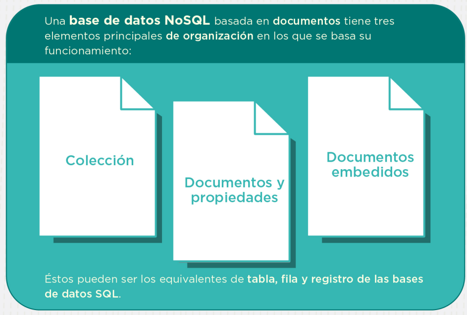

# Guía para MongoDB

## Índice

1. [Instalación y configuración](#1-instalción-y-configuración)
  - [Pasos de instalación](#pasos-de-instalación)
  - [Configuración de variables de entorno](#configuración-de-variables-de-entorno)
2. [Colecciones y documentos](#colecciones-y-documentos)

# 1. Instalación y configuración

## Pasos de instalación

1. Para habilitar el entorno de desarrollo, primero debes [descargar MongoDB](https://www.mongodb.com/try/download/community).
2. Ejecuta el instalador y acepta el acuerdo de la licencia gratuita. > [Next]
3. Da click en `Complete` para realizar la instalación completa de la base de datos.
4. Descarca la opción `Install DB as a Service` para evitar que el programa se ejecute permanentemente. > [Next]
5. Verifica que la opción `Install DB Compass` este marcada. > [Next]
6. Click en `Install`.

## Configuración de variables de entorno

1. Busca en la barra de tareas `Editar las variables de entorno del sistema`.
2. Click en `Variables de entorno...`.
3. Busca la carpeta donde se instalaron las librerias de la base de datos y tambien la ruta de la shell `mongosh` y copia ambas rutas. La direcciones suelen ser:
  - Para el servidor: `C:\Program Files\MongoDB\Server\8.0\bin`.
  - Para **mongosh**: `C:\Program Files\MongoDB\mongosh-2.2.5-win32-x64\bin`
5. En el área de `Variables de usuario`, da doble click en la variable `Path`
6. Da click en `Nuevo` y pega una de las rutas que copiaste y repite el paso para la otra ruta.
7. Ahora, haz click en `Aceptar` en todas las ventanas emergentes.
8. En la raiz `C:\` crea una carpeta llamada `data` y dentro crea otra llamada `db`.

Para verificar que la configuración funciona, abre el `Simbolo del sistema` y escribe `mongosh --version`, debería aparecer la versión de la shell de MongoDB.

# Colecciones y documentos

